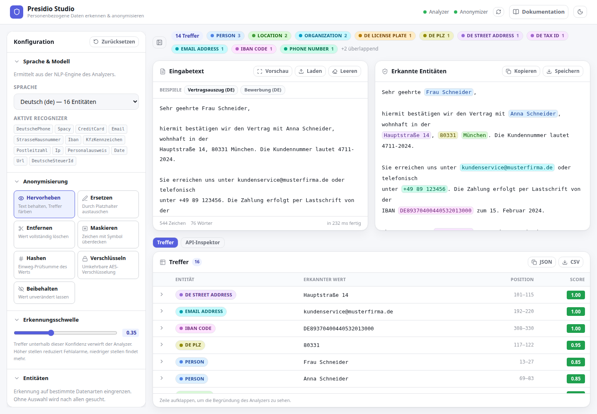
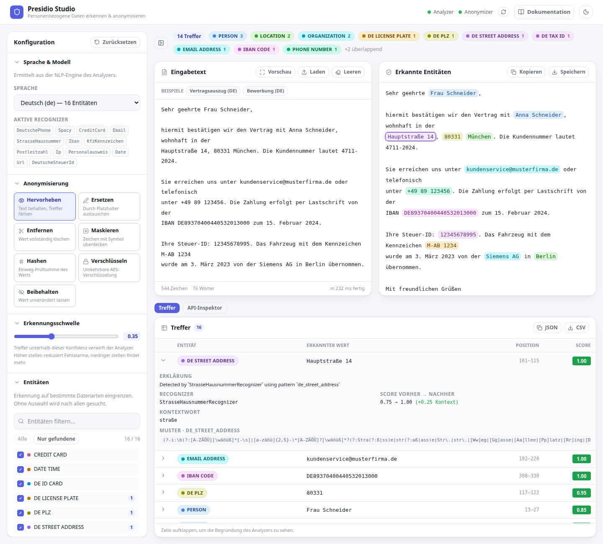
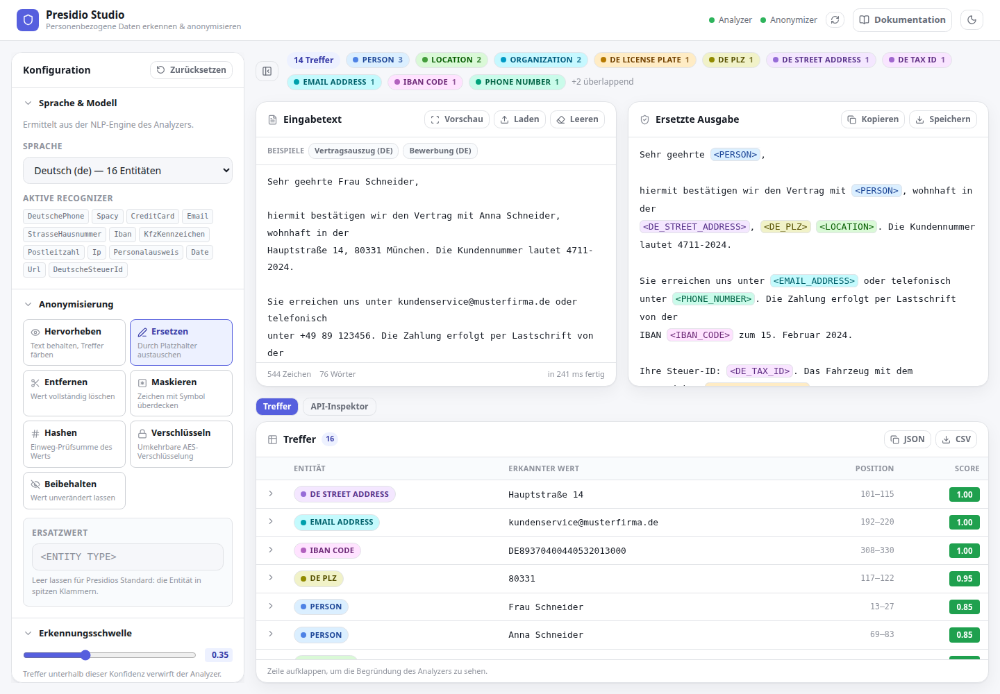
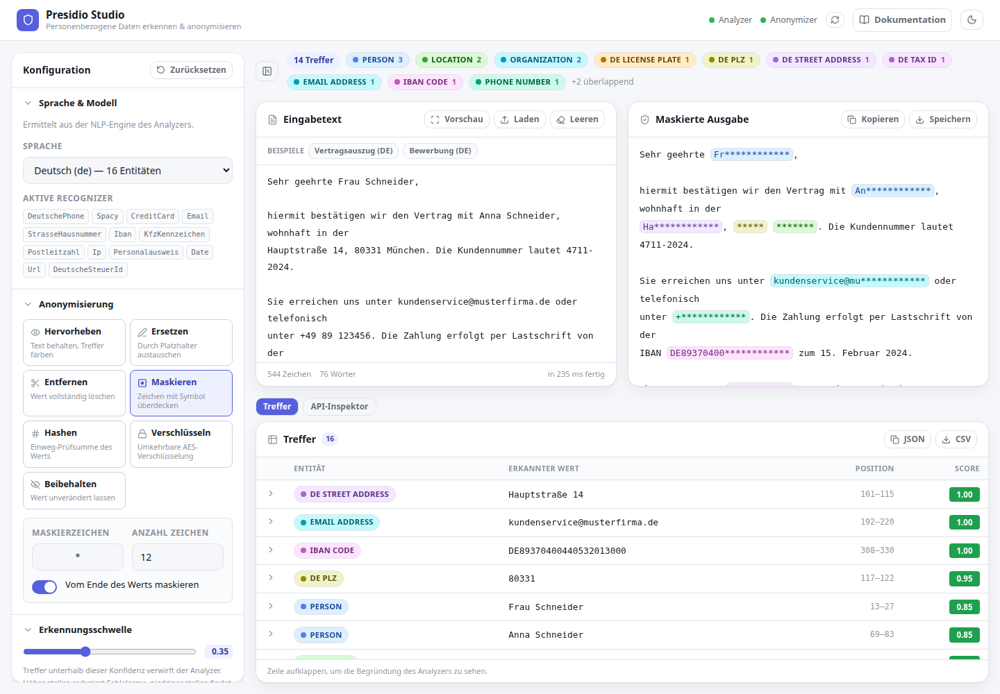
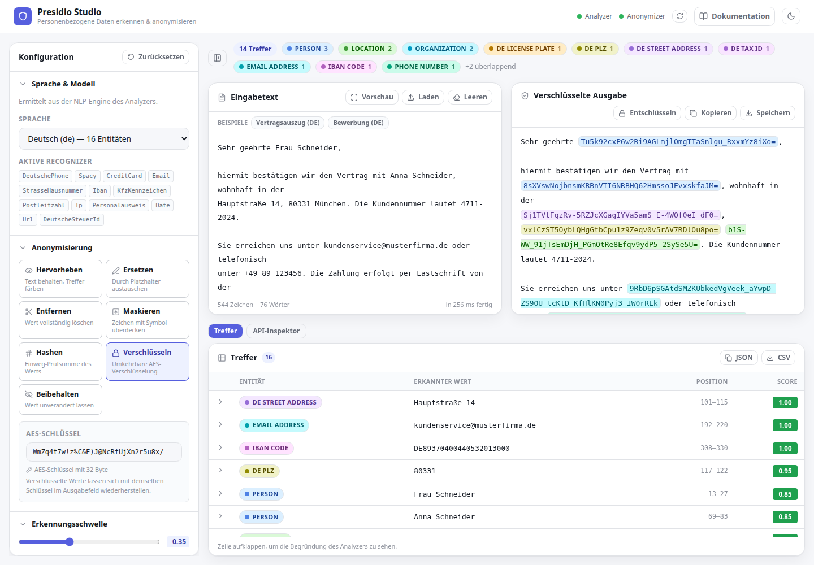
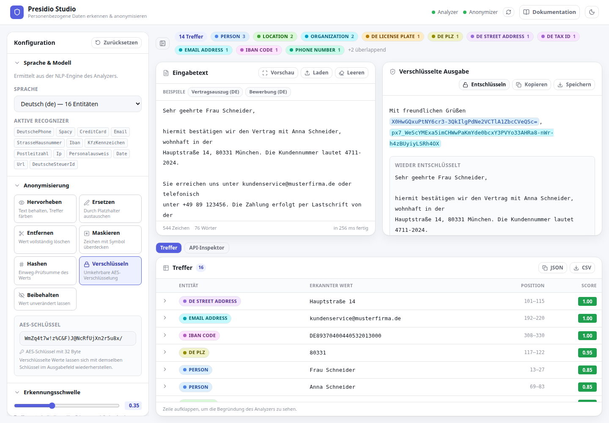
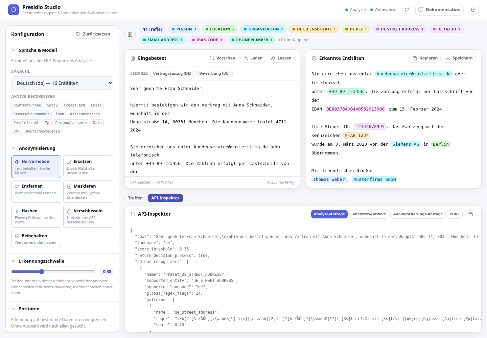
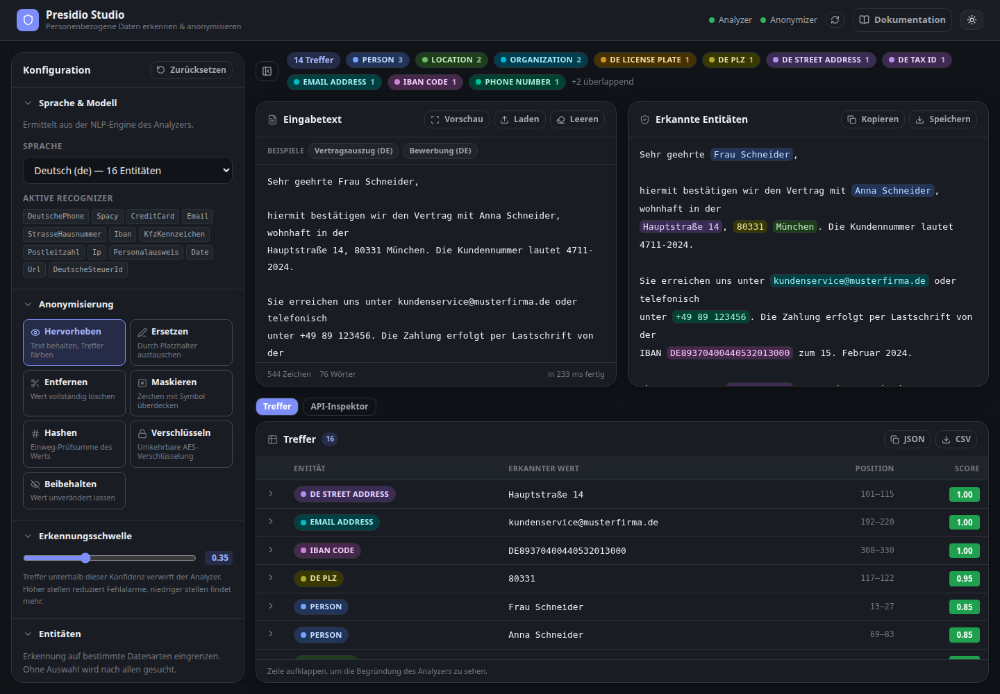

<div align="center">


# Presidio Studio

**A Vue 3 frontend for [Microsoft Presidio](https://microsoft.github.io/presidio/)** — paste text, watch personal
data light up as you type, and switch between seven de-identification strategies without leaving the page.


</div>

---

## About

Presidio is an open-source engine that finds personal data (names, addresses, IBANs, tax IDs …) in
text and anonymises it. It is a pair of REST services, an **Analyzer** and an **Anonymizer**, with no
user interface of its own. Presidio Studio is that interface, in the spirit of the
[official Hugging Face demo](https://huggingface.co/spaces/presidio/presidio_demo) but built against
**your own** services, so it works with whatever languages and custom recognizers you deploy.

It was built for German-language text, where the stock models have gaps: there is no recognizer for
streets or postal codes in any language. The app ships presets that close them without touching the
server, plus a server-side config for when you want the fix in the analyzer itself.

The interface and the built-in handbook are in **German**; code and this documentation are in English.

> **About the screenshots.** They were taken against a locally running Presidio deployment with
> English and German models, using the demo texts that ship in [`src/data/samples.ts`](src/data/samples.ts).
> All names, addresses, IBANs and numbers in them are invented.

## Screenshots

|  |  |
|:--:|:--:|
|  |  |
| **Highlight** — German contract excerpt, entities coloured by type, live counts on top | **Explainable findings** — recognizer, matched pattern and the score before and after context boosting |
|  |  |
| **Replace** — entities swapped for placeholders | **Mask** — characters hidden with a symbol, configurable per request |
|  |  |
| **Encrypt** — reversible AES, key validated as you type | **Decrypt** — the original text restored through `/deanonymize` |
|  |  |
| **API inspector** — the exact JSON sent to Presidio, plus a ready-to-run cURL | **Dark theme** — follows the system preference |

<div align="center">

<br><em><strong>Handbuch</strong> — a built-in manual at <code>#/doku</code>; the entity reference is fetched live from your analyzer</em>
</div>

## Features

- **Live analysis** — the pipeline re-runs shortly after every edit (toggleable)
- **Seven de-identification modes** — highlight, replace, redact, mask, hash, encrypt and keep, each with its own parameters
- **Reversible encryption** — AES-encrypt findings, then restore the original text through `/deanonymize` with one click
- **Language discovery** — the app probes the analyzer at startup and offers only the languages your deployment actually loaded (here English and German, including `DE_TAX_ID`, `DE_ID_CARD` and `DE_LICENSE_PLATE`)
- **Confidence threshold** and **entity filtering** with live per-entity counts
- **Address recognizers** — Presidio's models tag cities as `LOCATION` but ship no recognizer for streets or postal codes. Presets close that gap for German (`DE_STREET_ADDRESS`, `DE_PLZ`) and English (`STREET_ADDRESS`, `US_ZIP_CODE`); on by default, toggleable, and needing no change to the Presidio server
- **Allow lists** for phrases that must never be flagged
- **Ad-hoc recognizers** — deny lists and custom regex patterns, registered per request, with their own colours in every panel
- **Explainable findings** — the decision process behind every match: recognizer, pattern, score before and after context boosting, checksum validation
- **API inspector** — request and response JSON and a cURL command, so the UI doubles as API documentation
- **Export** findings as CSV or JSON, copy or download the de-identified text, drag in a `.txt` file

## Tech stack

| | |
|---|---|
| Framework | Vue 3.5 (Composition API, `<script setup>`) |
| State | Pinia 3, configuration persisted to `localStorage` |
| Language | TypeScript 5.9, type-checked with `vue-tsc` |
| Build | Vite 7 |
| Styling | Tailwind CSS 4 with a CSS-variable design system (light and dark) |
| Serving | nginx 1.27 container; endpoints configurable at container start |
| Backend | Microsoft Presidio Analyzer and Anonymizer (not included) |

## Architecture

```
Browser ──▶ Vite dev server / nginx ──▶ presidio-analyzer    :5002
                  (same origin)    └─▶ presidio-anonymizer  :5001
```

Presidio's services send **no CORS headers**, so a browser can never call them directly. Every request
therefore goes through a same-origin proxy: the Vite dev server in development, nginx in the container.
Both expose the services as `/api/analyzer` and `/api/anonymizer`.

## Points of interest

- **[`src/stores/presidio.ts`](src/stores/presidio.ts)** — one Pinia store owns configuration, the
  analyse-then-anonymise pipeline and persistence. Overlapping spans are resolved to the strongest
  match per region; the findings table still lists every raw result.
- **[`src/data/recognizerPresets.ts`](src/data/recognizerPresets.ts)** — the address presets. They are
  sent as ad-hoc recognizers per request, with flags chosen so that capitalisation matters (German and
  English street names depend on it) and postal codes require a neighbouring place name, so a bare
  five-digit order number is not flagged.
- **[`server/`](server/README.md)** — the same recognizers as analyzer-side YAML, a merge script that
  extends an existing registry **without overwriting it** (it aborts if the merge would drop or alter
  anything, keeps a timestamped backup and is safe to run twice), and a smoke test. Its README explains
  why the stock `DePlzRecognizer` was rejected: measured against a document with three decoy numbers it
  flagged all three, the replacement flagged none.
- **[`src/api/presidio.ts`](src/api/presidio.ts)** — the REST client with error handling and language
  discovery.

## Getting started

Requires Node 20+ and a reachable Presidio Analyzer and Anonymizer.

```bash
npm install
cp .env.example .env     # point the proxy at your Presidio services
npm run dev              # http://localhost:5180
```

`.env`:

```
PRESIDIO_ANALYZER_URL=http://localhost:5002
PRESIDIO_ANONYMIZER_URL=http://localhost:5001
```

No Presidio at hand? Run the official images `mcr.microsoft.com/presidio-analyzer` and
`mcr.microsoft.com/presidio-anonymizer` (they listen on container port 3000, so map them to 5002 and
5001). German support needs an analyzer configured with a German spaCy model.

### Docker

```bash
docker compose up -d --build   # http://localhost:8080
```

Or without Compose:

```bash
docker build -t presidio-ui .
docker run -d -p 8080:8080 \
  -e PRESIDIO_ANALYZER_URL=http://analyzer-host:5002 \
  -e PRESIDIO_ANONYMIZER_URL=http://anonymizer-host:5001 \
  presidio-ui
```

The endpoints are read at container start, so one image works against any Presidio deployment. On the
same Docker network as Presidio, use service names, e.g. `http://presidio-analyzer-de:3000`.

## Scripts

| Command | Purpose |
|---|---|
| `npm run dev` | Dev server with hot reload and the Presidio proxy |
| `npm run build` | Type-check and build to `dist/` |
| `npm run preview` | Serve the production build locally |
| `npm run typecheck` | Type-check only |

## Project layout

```
src/
├── api/presidio.ts            REST client, error handling, language discovery
├── stores/presidio.ts         Pinia store: configuration, pipeline, persistence
├── components/                Sidebar controls, editor, output, findings, API inspector, handbook
└── data/
    ├── entities.ts            Entity colours and descriptions
    ├── recognizerPresets.ts   Built-in address / postal-code recognizers
    └── samples.ts             Demo texts (EN + DE)
server/                        Analyzer-side recognizer config, merge script, smoke test
```

## Notes

- Presidio can return overlapping spans (an IBAN that also matches `ORGANIZATION`). The UI renders the
  strongest span per region and reports the rest as "overlapping".
- The AES key for the encrypt operator must be 16, 24 or 32 bytes; the sidebar validates it as you type.
- From the `lg` breakpoint up, the app is pinned to the viewport and each panel scrolls inside its own
  box; below that it falls back to normal document flow.
- Presidio is an aid, not a guarantee: it finds a lot, never everything. Legally binding anonymisation
  needs a human check of the result.

## License

No license has been chosen yet, so all rights are reserved.
